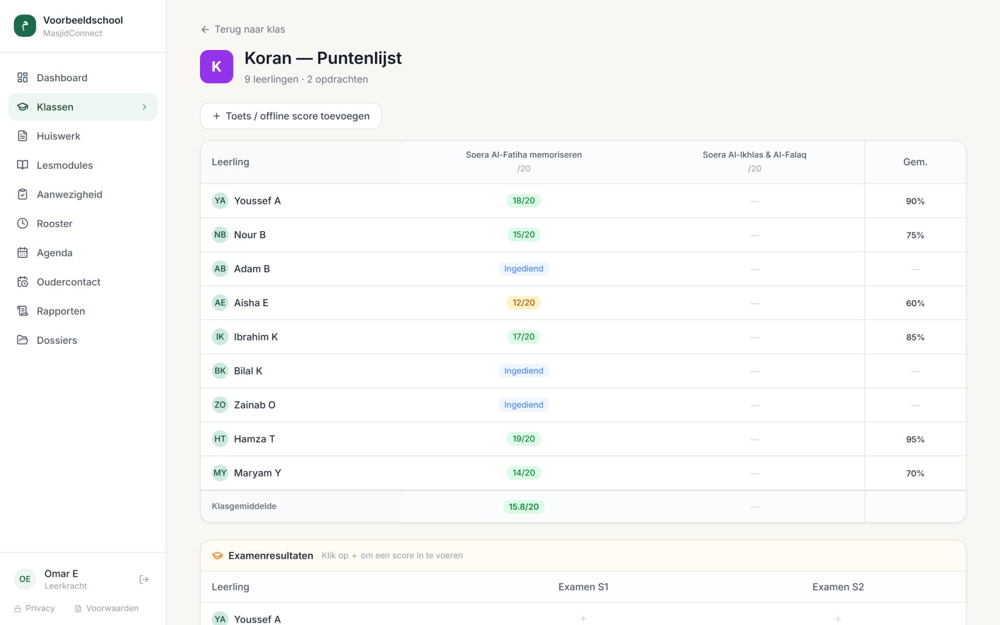
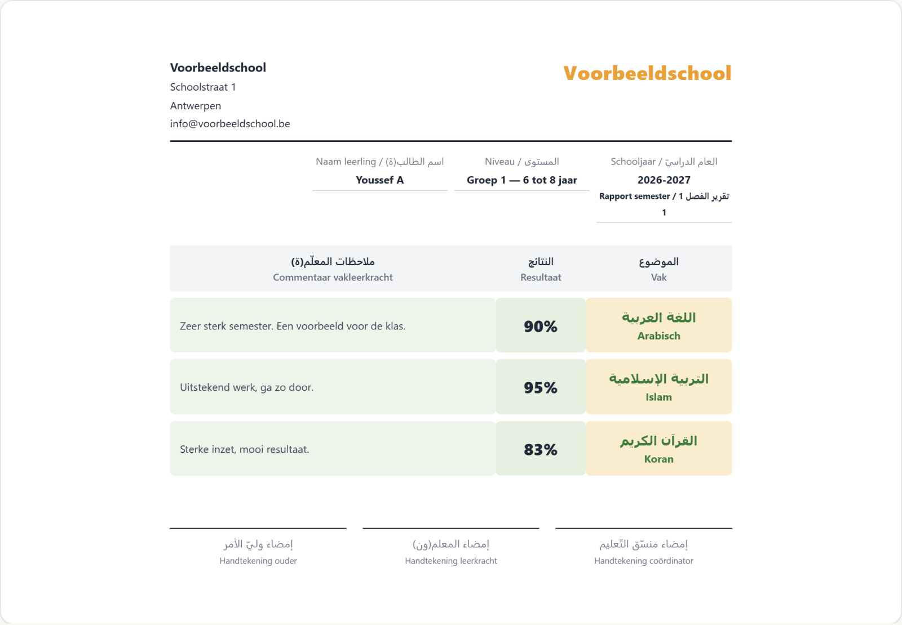
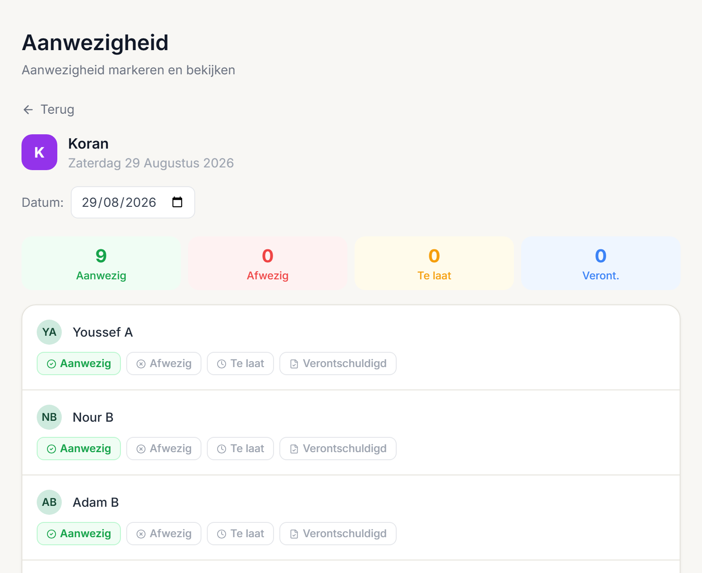
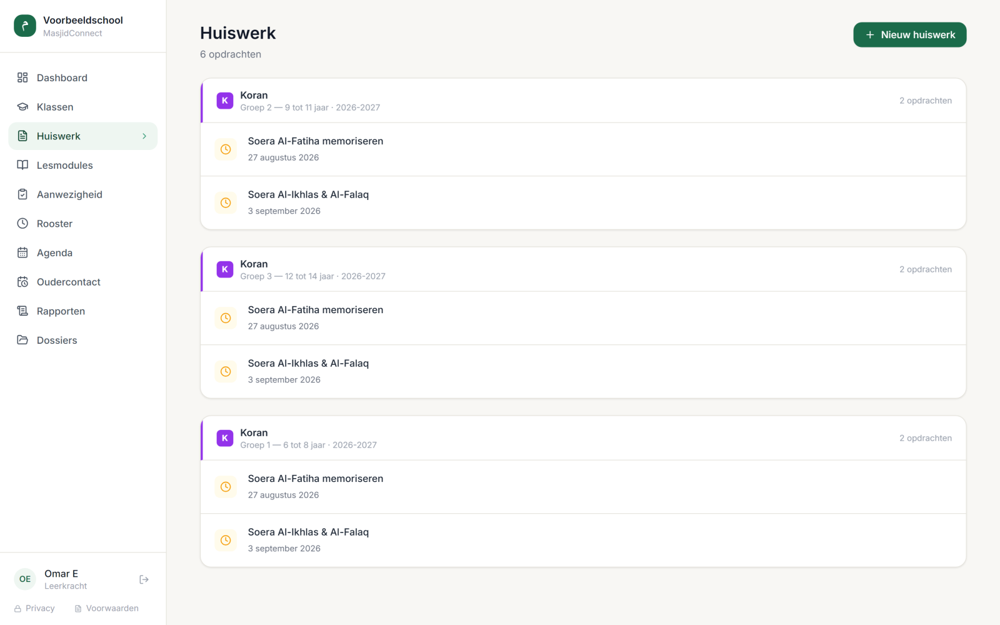
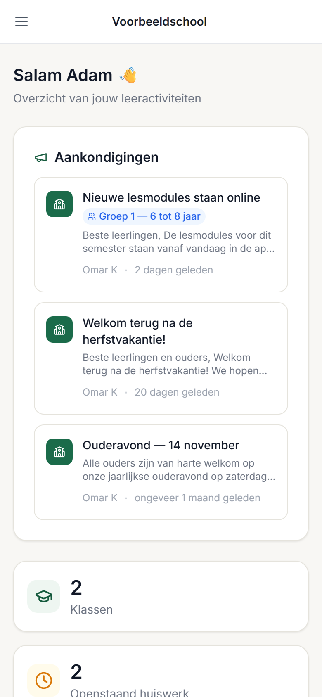

# MasjidConnect

A school platform for mosque weekend schools: the volunteer-run schools that teach Arabic and Qur'an to children on Saturdays and Sundays. The board manages classes, enrolment, fees and the school year; teachers set homework, keep a gradebook and take attendance; pupils (and the parents looking over their shoulder) see their homework, grades and report cards.

It has been in production at [masjidconnect.be](https://www.masjidconnect.be) ([English page](https://www.masjidconnect.be/en)) since September 2026, used by a paying school with over 100 pupils. I designed, built and run it alone: product, database, application code, deployment, support, and the GDPR paperwork with the school.

## Screenshots

The interface is in Dutch, the language of the schools it serves. Every name shown belongs to a demo school, stored as first name plus initial.

| Gradebook | Report card (Arabic / Dutch) |
| --- | --- |
|  |  |
| **Attendance** | **Homework** |
|  |  |

<p align="center"></p>

## What it does

- **Classes and groups.** One group per level, one class per subject. A pupil placed in a group is enrolled in all its subjects.
- **Homework.** For the whole class or per pupil, handed in as text or files, or done on paper; graded with a score and feedback.
- **Gradebook.** Homework, paper tests and exams in one grid, with a weighting each class can set. One function (`lib/grading.ts`) computes the average for every screen that shows one.
- **Attendance.** A class in under a minute, a yearly overview per pupil, and an alert when a pupil misses two lessons in a row.
- **Report cards.** Generated from the gradebook twice a year, printed with Arabic and Dutch side by side.
- **Board tools.** Pupil records, membership fees per pupil and per family, teacher payroll, announcements, parent-teacher meeting slots, a school document shelf, and a year-transition wizard.

## Architecture

**Multi-tenancy.** Every school is a tenant. Isolation is enforced in Postgres, not in application code. Every table has row-level security, and on top of the per-role policies each table carries one `RESTRICTIVE` policy, the *tenant wall*, which no permissive policy can widen. A query that forgets to filter by school still cannot return another school's rows. A migration guard refuses to finish if any table lacks its wall.

**Five roles.**

| Role | Scope |
| --- | --- |
| `super_admin` | Platform operator. Creates schools. |
| `admin` | The school board. Users, classes, fees, the school year. |
| `teacher` | Their own classes: homework, grades, attendance, report card comments. |
| `leerlingenbegeleiding` | Pupil counsellor. Reads pupil records and attendance, manages no classes. |
| `student` | Their own homework, grades and report cards. |

**Where privileged code runs.** The dashboard pages talk to Postgres directly through supabase-js, as the signed-in user, so row-level security is the boundary for all normal reads and writes. Operations that need more go through API routes (invites, archiving, erasure, export, deleting homework with its files). Each route verifies the caller's token and role, then uses one shared service-role client (`lib/supabase/admin.ts`), which never leaves the server.

**Storage.** Submitted work, course material, pupil documents, report PDFs and school documents sit in private buckets, readable only through short-lived signed URLs. Only school logos are public.

**The school year.** Classes belong to a school year. The transition wizard creates next year's groups and classes, copies the teacher assignments and moves the selected pupils up, leaving last year's classes, grades and attendance in place as history. If a step fails, it removes what it created.

## What broke against real data

Most of the interesting work happened after the first school started using it.

**A row-level security policy that never finished planning.** Pupils reported that a PDF "wouldn't open": signing a storage URL took 6 to 30 seconds for a user and 115 ms for the service role. `EXPLAIN` showed 813 ms of *planning* and every subplan "never executed". Each policy's `EXISTS` subquery pulled in other tables' policies, which pulled in more, recursively. The fix was to move those subqueries into `SECURITY DEFINER` functions, which the planner cannot see into. The same pattern later caused statement timeouts when grading. With the same fix applied, grading went from 1.9–6.7 s (plus timeouts) to 87 ms on average.

**Policies that were correct but slow.** A full-year attendance read cost an admin about 1.8 s on a benchmark. Rewriting the tenant wall on the two largest tables as a set-based lookup (`session_id IN (SELECT my_tenant_attendance_session_ids())` instead of a per-row check on each record) took it to 14 ms, and made reads 10–100× faster across the benchmark. CI proves that nobody can see anything they could not see before.

**Proving the tenant wall in CI.** Per-policy tenant checks kept being the weak spot as tables were added, which is why the wall exists. The CI job `rls-bench` builds the schema in an empty Postgres and seeds two schools. It replaces every policy with `USING (true)` and checks that the wall alone still blocks reads and writes across schools. It also checks that each school sees exactly the same rows of its own with and without the wall, and that every migration's rollback restores the exact previous policies. Its first run found a real bug: a profile update check that would have let a user move themselves to another school.

**The silent 1000-row cap.** PostgREST returns at most 1000 rows per select and says nothing. A school's exit export came back with exactly 1000 of its 1215 attendance records. Large reads now page with `.range()` on a stable order, and long `.in()` filters are split into chunks of 200 ids, because past roughly 300 ids the URL itself fails.

**Errors that looked like empty data.** supabase-js never throws. A call that ignores `error` turns a failed read into an empty list and a failed write into apparent success. Here, a failed read could show a pupil a wrong average, or open an empty form that would overwrite a parent's contact details when saved. All 123 such calls were fixed, and a lint rule now rejects any new one.

**An auth deadlock.** Users of the installed app had to log in again every day. Awaiting a database call inside supabase-js's `onAuthStateChange` callback deadlocks on the SDK's own auth lock after a silent token refresh, which froze the app on its loading screen. Callbacks now stay synchronous.

**Erasure has to reach Storage.** Deleting a user cascades through the tables but leaves the uploaded files in their buckets, and the rows that pointed at them are gone. All erasure goes through `lib/gdpr-erasure.ts`. It deletes the files first, deletes what is wholly about the person, clears free text from rows kept for statistics, and reports a partial erasure as a failure. `lib/personal-data-map.ts` lists, per table, what is deleted, cleared or kept, and the data export reads the same map.

## Tests and CI

GitHub Actions runs a typecheck, lint (including the unchecked-Supabase-error rule) and the `rls-bench` job described above on every pull request and every push to `master`. `scripts/rls-smoke.ts` signs in as each demo role against a live project and checks the role and school boundaries, including two writes that must be refused. There are no unit tests yet; tests for the grading function come first.

## Stack

Next.js 15 (App Router) and React 19, in TypeScript. Supabase for Postgres, auth and storage, hosted in the EU (Ireland). Tailwind CSS. Deployed on Vercel. Resend for e-mail, Upstash Redis for rate limiting the API routes.

## Project structure

```
app/
  (dashboard)/        The signed-in app: dashboard, klassen, huiswerk, aanwezigheid,
                      rapporten, dossiers, betalingen, beheer, superadmin, ...
  api/                Privileged routes: invite, export, user archive/erase, ...
  afdrukken/          Print layouts (report cards)
  page.tsx, en/       Public landing pages (Dutch, English)
components/           UI, grouped by feature
lib/
  grading.ts          The only place an average is computed
  gdpr-erasure.ts     Erasure, including Storage
  personal-data-map.ts  What happens to each table on erasure and export
  supabase/           Browser client and the server-only service-role client
supabase/
  schema.sql          Base schema snapshot
  NN_*.sql            Numbered migrations, most with a matching rollback
scripts/
  rls-bench/          The tenant-wall test bench run in CI
  rls-smoke.ts        Role-by-role access checks
```

## Running locally

```bash
npm install
cp .env.example .env.local   # fill in a Supabase project's URL and keys
npm run dev
```

The database is the base snapshot in `supabase/schema.sql` followed by the numbered migrations from 14 on, in order (the snapshot predates several of them). `scripts/rls-bench/load.sh` builds it exactly that way in an empty Postgres and is the reference. There is no one-command local Supabase setup yet.

| Variable | Purpose |
| --- | --- |
| `NEXT_PUBLIC_SUPABASE_URL`, `NEXT_PUBLIC_SUPABASE_ANON_KEY` | Supabase project |
| `SUPABASE_SERVICE_ROLE_KEY` | Server only; used by the API routes |
| `NEXT_PUBLIC_SITE_URL` | Base URL for links in invitation e-mails |
| `RESEND_KEY` | Sends the landing page's contact form |
| `UPSTASH_REDIS_REST_URL`, `UPSTASH_REDIS_REST_TOKEN` | Optional rate limiting |
| `DISCORD_FEEDBACK_WEBHOOK_URL` | Optional: forwards in-app feedback |
